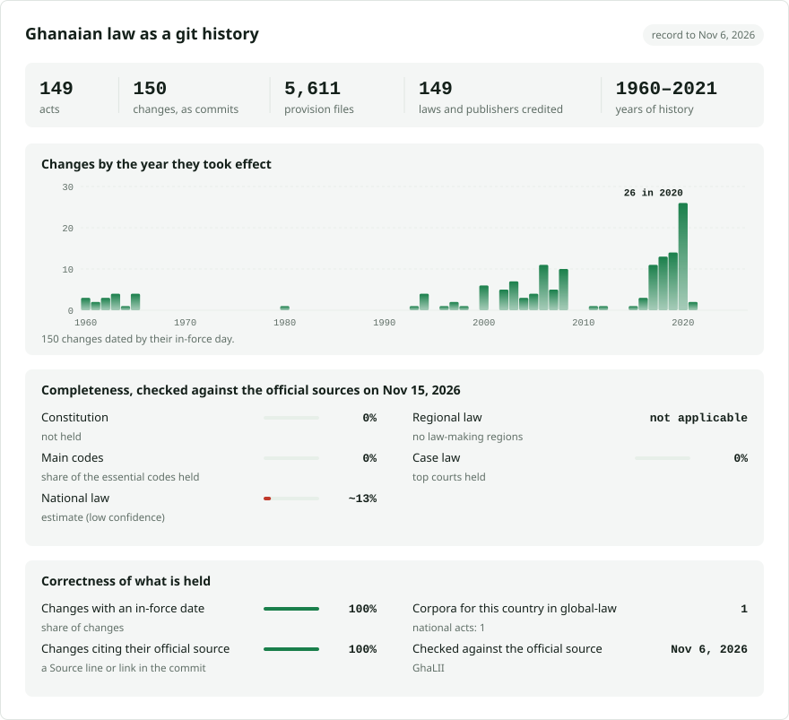

# Ghana: law history in git

<picture>
<source media="(prefers-color-scheme: dark)" srcset="data/effort-dark.svg">

</picture>

The law of Ghana as a git history: one file per section, one commit per version on the day it took effect, and the Act that made each change as the commit's author. `git blame` names the Act behind every line; `git log` lists every change to a section; picking a date gives the text held for that day. Most Acts here are their text as passed: amending Acts are held as their own texts and are not applied to the Acts they amend.

Part of [lexifina/global-law](https://github.com/lexifina/global-law), one git history for every country's law: this is Ghana's national law, which global-law reads at `ghana/national/acts/`.

**What is in it now:** 149 Acts of Parliament from 1960 to 2021, with 150 versions: 145 from the Parliament of Ghana Library's repository, 143 of them as passed and 2 (the Electronic Transactions Act, 2008 and the Corporate Insolvency and Restructuring Act, 2020) in the Library's consolidated edition; 3 from GhaLII, the Data Protection Act, 2012, the Companies Act, 2019 and the Renewable Energy Act, 2011 (2 versions, the second as amended by Act 1045 of 2020); and the Cybersecurity Act, 2020, from the Assembly Press print. [`data/laws.csv`](data/laws.csv) lists every law in the record with its dates and source, and each Act's folder has a `README.md` listing its provisions.

Each Act is in `acts/<year>/<number>-<short name>/`, one file per section (`acts/2003/651-labour/sec-020.md` is section 20, leave entitlement, of the Labour Act, 2003 (Act 651)); five Acts (772, 941, 1005, 1015 and 1031) are each one `whole-act.md`, with their whole printed text. Until 26 November 2026 the folders were `act/<year>/<number>/`, and until 11 November 2026 they were named by the Act's id (`act-0651/`, `data-protection/`); [`data/paths.json`](data/paths.json) maps each id to its folder, and `git blame`, `git log --follow` and `tools/on.py` reach back through the moves. [`STRUCTURE.md`](STRUCTURE.md) describes the layout.

The text is in English, the language Ghana's laws are made in, as each source prints it.

## Questions as git commands

| Question | Command |
| --- | --- |
| Every change to section 20 of the Labour Act | `git log --follow -p --word-diff -- acts/2003/651-labour/sec-020.md` |
| Which Act wrote each line of section 20? | `git blame acts/2003/651-labour/sec-020.md` |
| Every version of section 20, with the day each took effect | `git log --follow --diff-filter=AM --format="%h %(trailers:key=In-force,valueonly,separator=) %an" -- acts/2003/651-labour/sec-020.md` |
| Section 20 as held on 1 January 2010 | `python tools/on.py 2010-01-01 acts/2003/651-labour 20` |

**Outside git**, we also host this record publicly, for free:

- **[Ask Claude about Ghanaian law](https://global-law.lexifina.com/v1/try_claude?country=ghana)**: opens Claude with a first question ready.
- **[Ask ChatGPT](https://global-law.lexifina.com/v1/try_chatgpt?country=ghana)**: the same question in ChatGPT.
- **[Search Ghanaian law on our site](https://lexifina.com/law?country=ghana&q=annual+leave)**: a search for "annual leave", with each provision's text and its versions, no account needed.
- **[Developer REST API](https://global-law.lexifina.com/v1/search_law?query=annual+leave&jurisdiction=ghana)**: the same search as JSON, with no key. See the [documentation here](https://lexifina.com/api/global-law).

Both assistants read the record through the free Global law connector (MCP, `https://global-law.lexifina.com/mcp`); the first time, the chat gives you the link that adds it. Ask in English.

**Host it yourself easily.** All it takes is git and Python, and the tools run on your machine:

```sh
git clone --depth 1 https://github.com/lexifina/global-law && cd global-law
python3 tools/countries.py add ghana/national/acts
python3 tools/law.py show 2026-01-01 ghana/national/acts/acts/2003/651-labour/sec-020.md
```

Opened in Claude Code, Cursor, VS Code or Codex, the clone also starts a local MCP server with the same tools ([MCP.md](https://github.com/lexifina/global-law/blob/main/MCP.md)).

## Dates

Each commit is dated at noon, Africa/Accra, on the day the version took effect, and carries it in its `In-force:` trailer:

- for an Act as passed, the date of assent printed on it (for Act 1005, its Gazette notification two days later); for the Acts added on 26 November 2026, the day a commencement section names where it names one (the reason is in `In-force-basis:`); a commencement set by an Executive Instrument is not shown;
- for the two consolidated editions, the Gazette notification day of the amending Act they include (Acts 1038 and 1031); no earlier text is given;
- for a GhaLII version, GhaLII's date: the commencement it states for the first version (the Data Protection Act's 16 October 2012, not its Gazette day), and for a later one the day the amendment it takes in came into force;
- git cannot store dates before 1970, so the 17 commits for Acts of 1960 to 1965 are dated from 1970-01-01, one second apart, with the real day in `In-force:`. Ask for a date with `tools/on.py`, not `git log --before`.

Each Act is credited to itself (`Act 651`), and the Renewable Energy Act's second version to the Act that amended it (`Act 1045 of 2020`). The two consolidated editions are credited to the publisher (`Parliament of Ghana Library`), and their commit messages name the Acts they include.

## How it is checked

- Every text is read by deterministic code from its source (a PDF's text layer, or GhaLII's HTML), with no OCR and no model; for the Library's Acts, every word from "AN ACT" to the Gazette notification line is in a file, checked letter for letter, and an Act whose sections are not numbered without a gap is left out.
- Each GhaLII version is parsed from an archived copy of exactly that version's page; [`data/versions.json`](data/versions.json) has the sha256 of the source behind every version.
- `tools/check_repo.py` reads every version back from git on the day it took effect and on the day before, and compares it with the corpus: 150 versions of the first 149 Acts, 0 mismatches (see [`REPRODUCE.md`](REPRODUCE.md)). The Acts added on 26 November 2026 (`tools/parliament/build.py`) are taken only when their sections run 1..N without a gap, match the Arrangement of Sections, and keep every word of the text layer from the first section on.
- History is append-only: new Acts and versions go on top (`tools/append.py`), and no published commit is rewritten.
- [vulnerabilities/](vulnerabilities/): possible drafting mistakes in this law, found by global-law's detectors and checked by hand. Not run yet.

## What it does not show

- **Amendments applied to the Acts they amend.** Except for the Renewable Energy Act and the two consolidated editions, each Act is its text as passed; amending Acts are their own folders.
- **Later commencement days.** An Act as passed is dated by its assent, even where it came into force later (except where a commencement section of an Act added on 26 November 2026 names the day).
- **Core codes held only as scans or consolidations.** The Criminal Offences Act, 1960 (Act 29), the Criminal and Other Offences (Procedure) Act, 1960 (Act 30) and the Evidence Act, 1975 (NRCD 323) are not here: the Library holds Acts 29 and 30 only as scanned Revised Editions, and the copies on government sites found so far lose words in their text layer.
- **The Constitution.** The Constitution of 1992, as made and as amended by Act 527 of 1996, is on the `preview` branch only (`git show origin/preview:constitution/art-001.md`): it is read from unofficial compilations and waits for a check against an official print.
- **Most Ghanaian law.** No Legislative or Executive Instruments and no case law; Acts the Library holds only as scanned prints are not here, since no OCR is used.
- **Headings and notes.** Part and group headings above a section and GhaLII's editorial notes are left out of the section files, which start with their section's number and title.

## Sources

| Source | Kind | Past versions | Notes |
| --- | --- | --- | --- |
| [Parliament of Ghana Library repository](https://repository.parliament.gh/) | Typed editions of Acts as passed; some consolidated editions ("As amended by") | no, one text per Act | 145 Acts; the PDFs' text layer |
| [GhaLII](https://ghalii.org), the Ghana Legal Information Institute (Laws.Africa) | Point-in-time versions of Acts | yes, dated versions with their amendment history | 3 Acts, read from archived copies on the [Internet Archive](https://web.archive.org) |
| [Data Protection Commission](https://dataprotection.org.gh) | The Assembly Press print of the Cybersecurity Act, 2020 | no | The Act as passed |

## Licence

See [`LICENSE`](LICENSE). The GhaLII texts are under CC BY-NC 4.0, crediting GhaLII as the source, so they may be used only for non-commercial purposes; the Parliament Library's repository states no licence or terms (under the Copyright Act, 2005 (Act 690), section 3, copyright in works made for the Government vests in the Government). Lexifina's arrangement, commit messages, tables and tools are CC0 1.0.

No AI model wrote, translated or corrected legal text, and none runs when the history is built; the scripts were written by AI models (Claude Opus 5.5 and GPT-6), as [`REPRODUCE.md`](REPRODUCE.md) records.

## Visualisations

- [visualisations/](visualisations/): charts drawn from this repository. Not drawn yet.

## More

From [lexifina/global-law](https://github.com/lexifina/global-law):

- [FEATURES.md](https://github.com/lexifina/global-law/blob/main/FEATURES.md): every feature, and what every corpus must support (`git blame`, `law.py`, the MCP tools)
- [FAQ.md](https://github.com/lexifina/global-law/blob/main/FAQ.md): questions and answers · [CONTRIBUTING.md](https://github.com/lexifina/global-law/blob/main/CONTRIBUTING.md): proposing changes · [MCP.md](https://github.com/lexifina/global-law/blob/main/MCP.md): the MCP server · [REPRODUCE.md](https://github.com/lexifina/global-law/blob/main/REPRODUCE.md): how it was built · [CHANGELOG.md](https://github.com/lexifina/global-law/blob/main/CHANGELOG.md)
- [FRESHNESS.md](https://github.com/lexifina/global-law/blob/main/FRESHNESS.md): how current each corpus is · [Monitoring](https://github.com/lexifina/global-law/tree/main/monitoring): whether updates are running · [WATCHING.md](https://github.com/lexifina/global-law/blob/main/WATCHING.md): how each official source is watched for changes
- [performance/](https://github.com/lexifina/global-law/tree/main/performance): how fast the tools are, measured
- [visualisations/](https://github.com/lexifina/global-law/tree/main/visualisations): charts and bridges across the world's law
- [Vulnerabilities](https://github.com/lexifina/global-law/tree/main/vulnerabilities): mistakes in legislation as published
